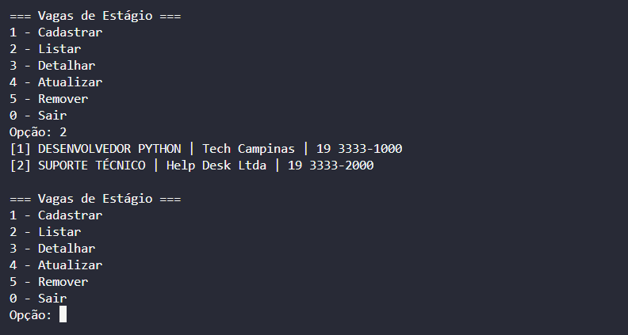
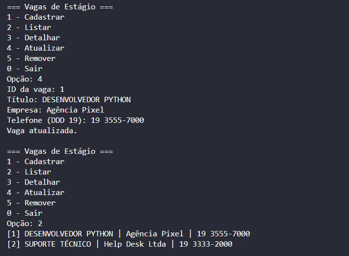

# Relatório — CRUD de vagas com SQLite

## 1. Como o projeto funciona

### 1.1 Qual é o objetivo da aplicação e o que é um CRUD?

O objetivo da aplicação é cadastrar vagas de estágio, informando o título da vaga, o nome da empresa e o telefone da empresa. O telefone deve começar com o DDD 19, pois o sistema só aceita esse DDD. Além disso, após cadastrar as vagas, o usuário pode atualizá-las, consultar seus detalhes por meio do ID, listar as vagas cadastradas e remover alguma vaga.

CRUD é um conjunto de operações utilizadas para manipular informações em um banco de dados, sendo elas:

- **C — Create (criar):** cadastrar informações.
- **R — Read (ler):** consultar ou listar informações.
- **U — Update (atualizar):** modificar informações existentes.
- **D — Delete (deletar):** remover informações.

### 1.2 Qual é o caminho que um dado percorre quando o usuário cadastra uma vaga, do menu no terminal até o arquivo `vagas.db`?

Quando o usuário escolhe a opção de cadastrar uma vaga, o sistema executa a função `cadastrar()`, que chama `ler_dados()` para receber as informações digitadas pelo usuário por meio dos inputs.

Depois de receber essas informações, a função `cadastrar()` chama `crud.criar_vaga()`, localizada no arquivo `crud.py`. Essa função executa um comando `INSERT` para inserir uma nova linha na tabela `vaga`, respeitando as regras definidas no arquivo `schema.sql`.

O ID é gerado automaticamente pelo SQLite por meio do `AUTOINCREMENT`. Após a execução do comando e a confirmação com `commit()`, as informações ficam armazenadas no banco de dados `vagas.db`.

### 1.3 Qual é o papel de cada arquivo: `app.py`, `crud.py` e os scripts em `sql/`?

O **app.py** é responsável por apresentar as opções ao usuário e executar as funções correspondentes de acordo com a opção escolhida, utilizando as funções do arquivo `crud.py`.

O **crud.py** contém as funções responsáveis por realizar as operações no banco de dados, como cadastrar novas vagas, listar, consultar, atualizar e remover vagas, utilizando as operações CRUD (Create, Read, Update e Delete).

Os **scripts SQL** são responsáveis por definir a estrutura do banco de dados, criar tabelas, estabelecer restrições para os dados inseridos e fornecer comandos SQL para manipular os dados. Por exemplo, o `schema.sql` define as características da tabela e utiliza o `AUTOINCREMENT` para gerar automaticamente o ID de cada vaga.

---

## 2. Exemplo de execução

Execute a aplicação pelo terminal:

```bash
python src/app.py
```

### Passo 1 — Cadastro da primeira vaga

Nesse passo, as informações são inseridas e o `crud.py` realiza o cadastro no banco de dados. São utilizadas as funções `ler_dados()`, `cadastrar()` e `crud.criar_vaga()`.

Depois, o sistema mostra que a vaga foi cadastrada e informa seu ID.


### Passo 2 — Cadastro da segunda vaga

Nesse passo, as informações da segunda vaga são inseridas. O sistema utiliza novamente as funções `ler_dados()`, `cadastrar()` e `crud.criar_vaga()` para armazenar os dados e mostrar a confirmação do cadastro com seu ID.


### Passo 3 — Listagem das vagas

Nesse passo, o sistema mostra as vagas cadastradas por meio das funções `listar()` e `crud.listar_vagas()`, que utilizam um comando `SELECT` para buscar as informações e organizá-las pelo ID em ordem crescente.



### Passo 4 — Atualização de uma vaga

Nesse passo, escolheremos a opção 4 (Atualizar). Ao selecioná-la, o usuário deverá informar o ID da vaga que deseja atualizar. Depois, poderá inserir as novas informações, como título, empresa e telefone.

Para realizar essa operação, o sistema utilizará as funções `atualizar()`, `ler_id()`, `crud.buscar_vaga()`, `ler_dados()` e `crud.atualizar_vaga()`.

Após a atualização, o sistema exibirá a mensagem "Vaga atualizada.". Podemos conferir as alterações escolhendo a opção 2 (Listar).



### Passo 5 — Remoção de uma vaga

Nesse passo, escolheremos a opção 5 (Remover), que solicitará o ID da vaga que desejamos remover. Após informar o ID, o sistema utilizará as funções `remover()`, `ler_id()` e `crud.remover_vaga()` para excluir o registro do banco de dados.

Depois da remoção, a vaga não aparecerá mais na listagem.


---

## 3. Explicação de uma função: `listar_vagas()`

### 3.1 Qual comando SQL a função executa e o que cada parte dele faz?

A função `listar_vagas()` executa o seguinte comando SQL:

```sql
SELECT id, titulo, empresa, telefone
FROM vaga
ORDER BY id
```

- **SELECT id, titulo, empresa, telefone:** solicita os dados dessas quatro colunas.
- **FROM vaga:** indica que os dados serão consultados na tabela `vaga`.
- **ORDER BY id:** organiza os resultados pelo ID em ordem crescente.

O comando SQL é armazenado em uma variável chamada `sql`. Depois, a função executa:

```python
return conexao.execute(sql).fetchall()
```

- **conexao:** representa a conexão com o banco de dados SQLite.
- **execute(sql):** executa o comando SQL armazenado na variável `sql`.
- **fetchall():** retorna todas as linhas encontradas na consulta, em uma lista de resultados.

### 3.2 Por que os valores são passados com o marcador `?` em vez de serem colocados diretamente no texto do SQL?

A função `listar_vagas()` não utiliza o marcador `?`, pois sua consulta não recebe um valor variável. Porém, outras funções do projeto, como `criar_vaga()`, `buscar_vaga()`, `atualizar_vaga()` e `remover_vaga()`, utilizam esse marcador quando precisam receber valores.

O `?` funciona como um espaço reservado (*placeholder*). Ele é utilizado porque o valor que ficará naquela posição pode variar conforme o que o usuário digitar.

Além disso, passar os valores separadamente ajuda a proteger o sistema contra SQL Injection e evita problemas na montagem dos comandos SQL.

### 3.3 O que a função devolve e como `app.py` usa esse retorno?

A função `listar_vagas()` devolve uma lista contendo todas as vagas encontradas no banco de dados, com suas informações organizadas em ordem crescente pelo ID.

No `app.py`, essa lista é armazenada em uma variável chamada `vagas`. Depois, o sistema percorre essa lista e utiliza a função `mostrar()` para exibir as informações de cada vaga de forma organizada no terminal.

---

## 4. Encontre o easter egg 🥚

### 4.1 Qual regra foi descoberta e onde ela está definida?

No campo **empresa**, o banco exige que o nome tenha pelo menos 3 caracteres. Já no campo **telefone**, o número obrigatoriamente precisa começar com o DDD 19.

Essas regras estão definidas no arquivo `schema.sql`, por meio das restrições `CHECK`:

```sql
empresa TEXT NOT NULL CHECK (length(empresa) >= 3),
telefone TEXT NOT NULL CHECK (telefone LIKE '19%')
```

### 4.2 O que acontece quando uma regra é violada? Qual erro aparece e de onde ele vem?

Quando alguma dessas regras é violada, os dados não são inseridos no banco de dados e aparece uma mensagem de erro.

Se a exigência da empresa não for cumprida, aparece:

```text
O banco recusou os dados: CHECK constraint failed: length(empresa) >= 3
```

Se a exigência do telefone não for cumprida, aparece:

```text
O banco recusou os dados: CHECK constraint failed: telefone LIKE '19%'
```

Esses erros vêm das restrições definidas no `schema.sql`. O SQLite identifica que uma regra foi violada e recusa a gravação. O `app.py` captura o erro e apresenta a mensagem ao usuário.

### 4.3 Por que vale a pena ter esse tipo de regra no próprio banco, e não só no código da aplicação?

É importante definir essas regras diretamente no banco de dados porque, caso aconteça algum erro no código da aplicação ou os dados sejam inseridos por outro programa, o próprio banco continuará verificando as informações e impedindo que dados fora dos critérios sejam armazenados.

Isso ajuda a manter a integridade e a consistência dos dados.
